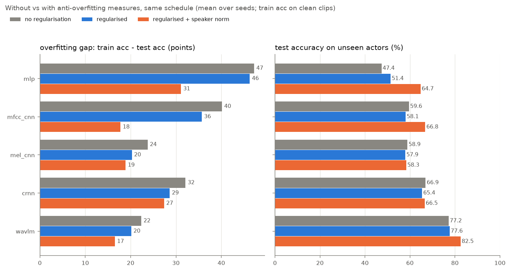

# Speech Emotion Recognition: 8 audio classifiers compared

> Detect emotion in speech, and find out which way of feeding audio to a model works best:
> raw waveform, MFCCs, mel-spectrograms, handcrafted features or a pretrained speech model.
> 7 neural models + an SVM baseline, all trained on the same data and split, evaluated on
> **speakers never seen during training**, with the overfitting measured and fixed.

**Keywords:** speech emotion recognition (SER) · audio classification · emotion detection · PyTorch · RAVDESS ·
WavLM · wav2vec2 · self-supervised learning · mel-spectrogram · MFCC · CNN · CRNN · raw waveform · SVM ·
overfitting · mixup · speed perturbation · speaker normalisation · speaker-independent evaluation


## Contents

1. [Results](#results)
2. [Overfitting: diagnosis and fixes](#overfitting-diagnosis-and-fixes)
3. [Audio samples](#audio-samples)
4. [Figures](#figures)
5. [Models](#models)
6. [Training and evaluation setup](#training-and-evaluation-setup)
7. [Quick start](#quick-start)
8. [Usage](#usage)
9. [Examples](#examples)
10. [Repository layout](#repository-layout)
11. [Dataset](#dataset)

## Results

RAVDESS speech, 8 emotions, speaker-independent test set (actors 21-24, 240 clips).
Mean ± sample std over 3 seeds. Chance = 12.5 %.

| model | input | test accuracy | test macro-F1 | params | train time / run ¹ |
|---|---|---|---|---|---|
| `wavlm_spk` ² | frozen WavLM states, speaker-normalised | **82.5** ± 0.4 % | 82.2 ± 0.6 % | 0.20 M ³ | 35 s ⁴ |
| `wavlm` | frozen WavLM states | **77.6** ± 0.5 % | 76.6 ± 0.3 % | 0.20 M ³ | 32 s ⁴ |
| `mfcc_cnn_spk` ² | MFCC sequence, speaker-normalised | **66.8** ± 0.2 % | 63.8 ± 0.3 % | 0.17 M | 187 s |
| `crnn_spk` ² | log-mel spectrogram, speaker-normalised | **66.5** ± 1.5 % | 63.0 ± 2.0 % | 0.32 M | 704 s |
| `crnn` | log-mel spectrogram | **65.4** ± 1.5 % | 63.4 ± 2.3 % | 0.32 M | 790 s |
| `mlp_spk` ² | handcrafted features, speaker-normalised | **64.7** ± 1.5 % | 62.9 ± 1.6 % | 0.10 M | 114 s |
| `svm_spk` ² ⁵ | handcrafted features, speaker-normalised | **62.9** % | 61.0 % | – | 3 s |
| `mel_cnn_spk` ² | log-mel spectrogram, speaker-normalised | **58.3** ± 0.7 % | 52.1 ± 1.4 % | 0.36 M | 592 s |
| `mfcc_cnn` | MFCC sequence | **58.1** ± 3.5 % | 56.2 ± 3.7 % | 0.17 M | 173 s |
| `mel_cnn` | log-mel spectrogram | **57.9** ± 3.3 % | 53.1 ± 4.4 % | 0.36 M | 838 s |
| `mlp` | handcrafted features | **51.4** ± 0.2 % | 50.2 ± 0.2 % | 0.10 M | 159 s |
| `svm` ⁵ | handcrafted features | **49.2** % | 48.0 % | – | 3 s |
| `wave_cnn` | raw waveform | **46.1** ± 3.5 % | 43.4 ± 5.0 % | 0.15 M | 309 s |
| `notebook_fnn` | notebook features (199-d) | **27.8** ± 4.2 % | 24.0 ± 3.9 % | 1.48 M | 461 s |

¹ On a shared 8-core CPU (other jobs running), no GPU.
² `*_spk` = the same model with **per-speaker normalisation** (see [below](#3-speaker-normalisation-the-fix-that-works)).
It needs a few *unlabelled* clips of each speaker, test speakers included, so it is a slightly different protocol:
the rows without `_spk` use nothing at all from the test speakers.
³ Trainable head only; the frozen WavLM backbone has 94 M parameters.
⁴ Excludes the one-off WavLM feature extraction (about 25 min on this CPU, cached afterwards).
⁵ The SVM is deterministic, so it is run once.

The same table is generated in [`results/RESULTS.md`](results/RESULTS.md).

### Key findings

- **A pretrained speech model wins by a wide margin.** A frozen WavLM plus a small head reaches 77.6 % on unseen
  speakers, and 82.5 % with speaker normalisation: 3× the original notebook pipeline (27.8 %). With only 1,080
  training clips, representations learned from large amounts of unlabelled speech beat every model trained from scratch.
- **The models overfit to the voices, not just to the clips.** Every model fits its training set (78-100 %) far
  better than new speakers. Classic regularisation narrows that gap only a little; normalising features per speaker
  narrows it a lot and lifts test accuracy by up to 17 points (see [Overfitting](#overfitting-diagnosis-and-fixes)).
- **Among models trained from scratch, time-frequency inputs beat raw audio.** The spectrogram and MFCC models
  (58-67 %) clearly beat the raw-waveform CNN (46 %), which has to learn its own filterbank from little data.
- **Modelling time helps.** The CRNN (CNN + BiGRU + attention) beats the plain 2D CNN on the same log-mel input
  by 7.5 points accuracy and 10 points macro-F1.
- **The feature pipeline matters.** The same feature families (MFCC, chroma, mel, contrast, tonnetz) go from 27.8 %
  with the notebook pipeline to 49-51 % with a better one (16 kHz audio with silence trimmed, log-mel, mean + std
  pooling, standardisation on train statistics) and to 63-65 % when standardised per speaker.
- **Hardest emotions:** *neutral* is often taken for *calm*, and *happy* for *surprised*; see the per-class F1 figure
  and the [audio samples](#audio-samples).

> Many published RAVDESS results (80-90 %+) use **random** splits, where the same actors appear in train and test.
> This repo tests on unseen actors, which is harder and closer to real use.

## Overfitting: diagnosis and fixes

### 1. Diagnosis

The first version of this repo logged train accuracy on *augmented* clips, which hid how much the models had
memorised. Train accuracy is now also measured the honest way, every epoch: in eval mode on 240 clean training clips.
Trained without any anti-overfitting measure, every model fits its training set almost perfectly and then loses
22-47 points on new speakers:

| model | train acc | test acc (unseen actors) | gap |
|---|---|---|---|
| `mlp` | 94.6 % | 47.4 % | 47.2 |
| `mfcc_cnn` | 99.7 % | 59.6 % | 40.1 |
| `crnn` | 99.0 % | 66.9 % | 32.1 |
| `mel_cnn` | 82.6 % | 58.9 % | 23.8 |
| `wavlm` | 99.6 % | 77.2 % | 22.4 |

(Mean over 3 seeds, at the checkpoint kept by early stopping.) With only 18 training actors, the easiest thing for a
model to learn is *who* is speaking (pitch range, timbre, recording level) and the way each actor acts each emotion,
and that does not transfer to a new voice.

### 2. Regularisation (applied to every model)

| measure | used by | what it does |
|---|---|---|
| stronger weight decay (AdamW 0.05) | all except `wave_cnn` | keeps the weights small |
| input dropout + higher dropout, smaller hidden layers | `mlp`, `wavlm` head | no single feature can be relied on |
| mixup (α = 0.4) | `mlp`, `wavlm` | trains on blends of two clips with blended labels |
| Gaussian noise on standardised features (σ = 0.2) | `mlp`, `wavlm` | features jitter every epoch |
| speed / pitch perturbation (0.9-1.1×) | `mfcc_cnn`, `mel_cnn`, `crnn` | resamples each clip so the model hears a slightly different voice every epoch |
| weight averaging (EMA, decay 0.995) | all except `wave_cnn` | the averaged weights are validated, checkpointed and tested |

Things that were tried and **dropped** because they hurt on validation: mixup on raw waveforms and on the CNN
embeddings (blending two voices), smaller or more heavily dropped-out WavLM heads, and any regularisation at all for
`wave_cnn`, which is limited by fitting rather than by overfitting (its train accuracy is only 80 % at the kept
checkpoint and still climbing), so it only gets a longer schedule (80 epochs). The
spectrogram CNNs train for 60 epochs instead of 40, since with speed perturbation they keep improving longer.

### 3. Speaker normalisation: the fix that works

Standardise every input feature **per speaker** instead of over the whole training set, so each speaker's clips
have zero mean and unit variance. This removes most of what makes one voice differ from another and keeps what changes
from one emotion to the next. For the CNNs, the log-mel front-end normalises each mel band with the speaker's own
statistics. At test time it needs a few unlabelled clips of the new speaker (`predict.py --speaker-ref`).

### 4. Before / after

Same model and schedule, with every measure off (`--baseline`, in [`results/baseline/`](results/baseline)) vs on:



| model | recipe | train acc | test acc | gap (train - test) |
|---|---|---|---|---|
| `mlp` | no regularisation | 94.6 % | 47.4 % | 47.2 |
| `mlp` | regularised | 97.6 % | 51.4 % | 46.3 |
| `mlp` | **regularised + speaker norm** | 95.8 % | **64.7 %** | **31.1** |
| `mfcc_cnn` | no regularisation | 99.7 % | 59.6 % | 40.1 |
| `mfcc_cnn` | regularised | 93.8 % | 58.1 % | 35.7 |
| `mfcc_cnn` | **regularised + speaker norm** | 84.6 % | **66.8 %** | **17.8** |
| `mel_cnn` | no regularisation | 82.6 % | 58.9 % | 23.8 |
| `mel_cnn` | regularised | 78.2 % | 57.9 % | 20.3 |
| `mel_cnn` | **regularised + speaker norm** | 77.2 % | **58.3 %** | **18.9** |
| `crnn` | no regularisation | 99.0 % | 66.9 % | 32.1 |
| `crnn` | regularised | 94.0 % | 65.4 % | 28.6 |
| `crnn` | **regularised + speaker norm** | 93.9 % | **66.5 %** | **27.4** |
| `wavlm` | no regularisation | 99.6 % | 77.2 % | 22.4 |
| `wavlm` | regularised | 97.8 % | 77.6 % | 20.1 |
| `wavlm` | **regularised + speaker norm** | 99.0 % | **82.5 %** | **16.5** |

What this shows, honestly:

- **Regularisation alone narrows the gap by 1-6 points** for every model, but changes test accuracy by no more than
  the seed-to-seed noise (+4.0 `mlp`, +0.4 `wavlm`, −1.0 to −1.5 for the CNNs).
- **Speaker normalisation is what closes the gap:** −22 points for `mfcc_cnn` (40 → 18), −16 for `mlp`, −6 for
  `wavlm`, with test accuracy up by +17 (`mlp`), +7 (`mfcc_cnn`) and +5 points (`wavlm`). The two 2D-CNN log-mel
  models gain little accuracy (`crnn` +1.1, `mel_cnn` +0.4 points, within seed noise), although their gap still
  shrinks a little.
- **A gap remains**, because 18 training voices are few; more speakers (or a larger corpus such as CREMA-D or
  MSP-Podcast) is the next step. Checkpoints are kept at the best *validation* macro-F1, so the overfitting never makes
  the reported test scores worse than the model's best epoch.

Rebuild the table and figure: `python compare.py --baseline --out results/baseline --models mlp mfcc_cnn mel_cnn crnn wavlm`,
then `python report.py`.

## Audio samples

Eight test clips, one per emotion, from actors never heard in training: [`samples/`](samples). All actors say the same
sentence ("Kids are talking by the door"), so only *how* it is said changes. Click a file, then download it to listen.

| clip | true emotion | `wavlm` prediction (top-3) | |
|---|---|---|---|
| [01_neutral_actor21.wav](samples/01_neutral_actor21.wav) | neutral | calm 55% · neutral 31% · happy 5% | ✗ |
| [02_calm_actor22.wav](samples/02_calm_actor22.wav) | calm | **calm 41%** · disgust 36% · sad 10% | ✓ |
| [03_happy_actor23.wav](samples/03_happy_actor23.wav) | happy | surprised 54% · happy 15% · fearful 11% | ✗ |
| [04_sad_actor24.wav](samples/04_sad_actor24.wav) | sad | **sad 33%** · happy 27% · disgust 25% | ✓ |
| [05_angry_actor21.wav](samples/05_angry_actor21.wav) | angry | **angry 76%** · happy 17% · neutral 3% | ✓ |
| [06_fearful_actor22.wav](samples/06_fearful_actor22.wav) | fearful | **fearful 75%** · happy 9% · sad 8% | ✓ |
| [07_disgust_actor23.wav](samples/07_disgust_actor23.wav) | disgust | **disgust 92%** · surprised 3% · angry 3% | ✓ |
| [08_surprised_actor24.wav](samples/08_surprised_actor24.wav) | surprised | **surprised 75%** · angry 10% · disgust 5% | ✓ |

6 / 8 correct. The two mistakes are the model's most common confusions on the whole test set. Reproduce with
`python examples/05_classify_samples.py --model wavlm`.


## Figures

All figures are regenerated from `results/*.json` by `python report.py`.

### Training curves

Train vs validation loss and accuracy per epoch, for every neural model (train = clean clips, eval mode). The line is
the mean over seeds, the band is the min/max, and the dotted lines mark the epoch kept by early stopping (best
validation macro-F1).


### Per-emotion F1


### Confusion matrices


## Models

One model per way of representing audio:

| model | what the model sees | architecture |
|---|---|---|
| `notebook_fnn` | 199 features from the original notebook: MFCC, chroma, mel, contrast and tonnetz averaged over the clip, min-max scaled per clip | the original Colab network: 6 dense ReLU layers (1000-750-500-250-100-50) |
| `svm` | 258 handcrafted features: 129 per-frame features (40 MFCC, 12 chroma, 64 log-mel, 7 contrast, 6 tonnetz), pooled with mean **and** std and standardised | RBF-kernel SVM, `C` tuned on validation |
| `mlp` | the same 258 features | input dropout → 2-layer MLP (256-128) with BatchNorm + dropout |
| `wave_cnn` | **raw waveform** (3 s at 16 kHz = 48,000 samples) | 1D CNN; a wide strided first conv learns its own filterbank (M5-style) |
| `mfcc_cnn` | **MFCC sequence** (40 coefficients × 151 frames) | 1D CNN over time, coefficients as channels |
| `mel_cnn` | **log-mel spectrogram** (64 mel bands × 151 frames) | 2D VGG-style CNN, spectrogram treated as an image |
| `crnn` | log-mel spectrogram | CNN → BiGRU → attention pooling over time |
| `wavlm` | **self-supervised speech model**: [WavLM base+](https://huggingface.co/microsoft/wavlm-base-plus), frozen | learned weighted sum of its 13 hidden layers (mean + std pooled over time) → input dropout → MLP head |

`*_spk` variants exist for `svm`, `mlp`, `mfcc_cnn`, `mel_cnn`, `crnn` and `wavlm`. The 7 neural models are defined in
`models.py`. The SVM (scikit-learn) is in `train.py`.

## Training and evaluation setup

- **Split:** by actor, so no test voice is heard during training. Train = actors 1-18 (1,080 clips),
  validation = actors 19-20 (120), test = actors 21-24 (240).
- **Audio:** resampled to 16 kHz, leading and trailing silence trimmed, then center-cropped or zero-padded to 3 s.
  `notebook_fnn` keeps the notebook's own loading (22.05 kHz, no trimming).
- **Training loop (all neural models):** AdamW, one-cycle learning-rate schedule, label smoothing 0.1, batch size 32,
  plus the anti-overfitting measures [above](#2-regularisation-applied-to-every-model). The validation macro-F1 is
  checked every epoch and the best checkpoint is kept for testing. `notebook_fnn` keeps the original architecture,
  features, learning rate (1e-4) and no extra regularisation, so it stays a faithful baseline.
- **Augmentation (waveform-input models):** random circular time shift (up to 0.3 s) and Gaussian noise at 15-40 dB SNR;
  `mfcc_cnn`, `mel_cnn` and `crnn` also get speed/pitch perturbation and SpecAugment (random time and frequency masks).
- **Metrics:** accuracy and **macro-F1**. *Neutral* has half as many clips as each other emotion (RAVDESS has no
  strong-intensity neutral), so macro-F1 is the fairer score. Per-epoch train/val loss, accuracy, macro-F1 and learning
  rate are saved in each `results/<model>_seed<n>.json`.

## Quick start

```bash
git clone <this-repo> && cd speech-emotion-recognition
pip install -r requirements.txt
python prepare_ravdess.py     # downloads RAVDESS (~200 MB), splits it by actor -> data/ravdess/{train,val,test}
python compare.py             # trains all models (3 seeds), writes results/RESULTS.md and every figure
```

`compare.py` is resumable: it skips any run whose `results/<model>_seed<n>.json` already exists.
The first run caches preprocessed audio and features in `cache/`. Delete that folder if you change the audio.
A GPU is used automatically when available (on Colab: *Runtime → Change runtime type → GPU*).

## Usage

```bash
# Train / evaluate one model (writes results/<model>_seed<n>.json + results/checkpoints/)
python train.py --model crnn
python train.py --model mel_cnn --seed 1
python train.py --model wavlm --speaker-norm          # -> wavlm_spk
python train.py --model mlp --baseline --out results/baseline   # anti-overfitting measures off

# Experiments: use a separate --out folder so the published results are not overwritten
python train.py --model crnn --epochs 100 --out results/exp_long
python train.py --model wavlm --backbone facebook/wav2vec2-base --out results/exp_w2v2   # any HF wav2vec2 / HuBERT / WavLM

# Your own data: a folder containing train/ val/ test/ subfolders of .wav files
python train.py --model mel_cnn --data /path/to/datasets

# Classify one clip (needs a trained checkpoint; top-3 emotions with probabilities)
python predict.py samples/05_angry_actor21.wav --model wavlm
python predict.py clip.wav --model wavlm_spk --speaker-ref folder_with_other_clips_of_that_speaker/

# Rebuild the tables and figures from results/*.json
python report.py
```

Labels are read from the file name:

- original RAVDESS names, such as `03-01-05-01-02-01-12.wav`: the 3rd field is the emotion
  (01 neutral, 02 calm, 03 happy, 04 sad, 05 angry, 06 fearful, 07 disgust, 08 surprised) and the 7th the actor
- any other `<a>-<b>-<emotion>.wav` name: the last field is the emotion (same codes); `--speaker-norm` needs RAVDESS names

## Examples

Short scripts that use the repo's modules from Python, runnable on a CPU ([`examples/`](examples)):

| script | what it shows |
|---|---|
| [`01_listen_to_samples.py`](examples/01_listen_to_samples.py) | the 8 sample clips: duration, loudness, pitch and log-mel spectrograms |
| [`02_train_svm.py`](examples/02_train_svm.py) | quickest real result: SVM on handcrafted features, per-emotion report on unseen actors |
| [`03_overfitting_fix.py`](examples/03_overfitting_fix.py) | the same MLP with and without the anti-overfitting measures: train/val gap and test accuracy |
| [`04_speaker_normalisation.py`](examples/04_speaker_normalisation.py) | per-speaker normalisation removes voice identity: about +12 points for the SVM |
| [`05_classify_samples.py`](examples/05_classify_samples.py) | classify the sample clips with a trained checkpoint, true vs predicted emotion |

## Repository layout

```
data.py              audio loading, labels + speaker ids, handcrafted + notebook features, speaker normalisation, caching
models.py            the 7 neural architectures, front-ends (LogMel, MFCC, SpecAugment), per-model training recipes
train.py             train/evaluate one model (incl. the SVM); regularisation, speaker norm, per-epoch metrics
compare.py           runs every model × seed (resumable), then builds the report
report.py            results tables + figures: accuracy, training curves, confusion matrices, per-class F1, overfitting
predict.py           inference on a single .wav file
prepare_ravdess.py   downloads RAVDESS and makes the speaker-independent split
samples/             8 test clips, one per emotion, with their true class and model predictions
examples/            numbered runnable scripts (see above)
results/             per-run metrics (JSON, incl. training history), RESULTS.md and the figures
results/baseline/    the same models trained with every anti-overfitting measure off
```

## Dataset

[RAVDESS](https://zenodo.org/records/1188976), speech subset: 1,440 clips from 24 professional actors and 8 emotions.
It is licensed CC BY-NC-SA 4.0. `prepare_ravdess.py` downloads it; only the 8 clips in `samples/` are redistributed
here, under the same licence.

> Livingstone SR, Russo FA (2018). *The Ryerson Audio-Visual Database of Emotional Speech and Song (RAVDESS).*
> PLoS ONE 13(5): e0196391. https://doi.org/10.1371/journal.pone.0196391

This project started from a Colab notebook (*speech_sentiment_analysis with FNN*). Its pipeline is kept as the
`notebook_fnn` baseline, so every other model is measured against it.
