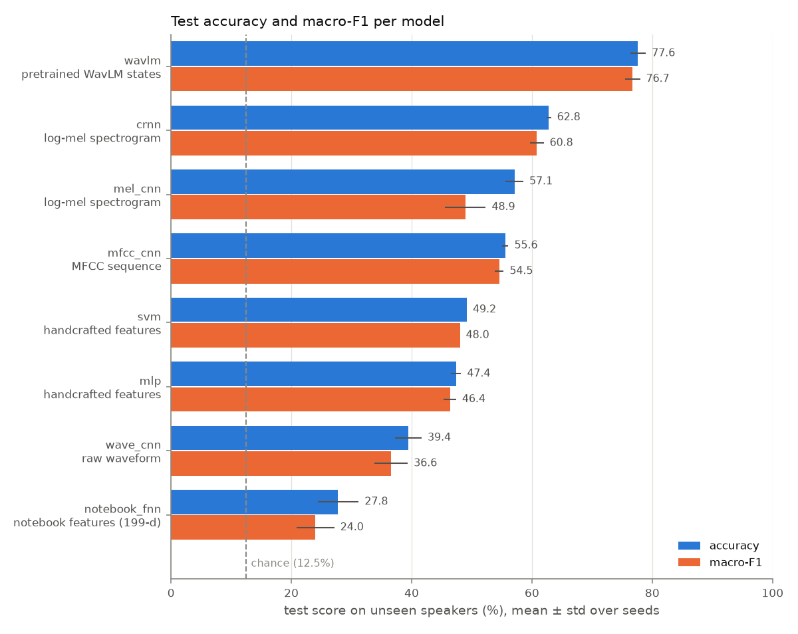
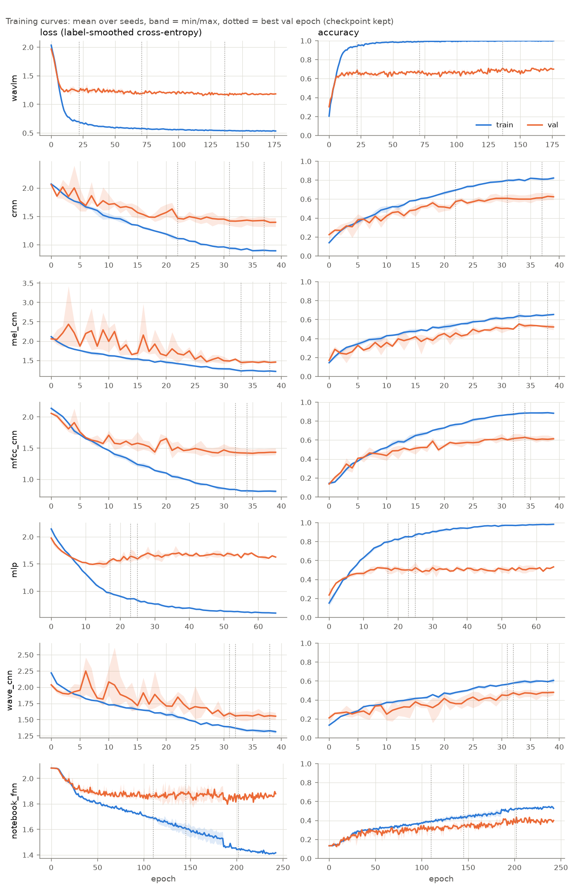
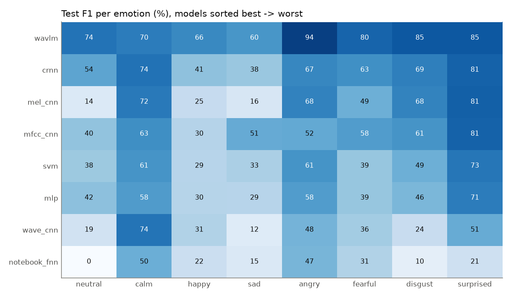
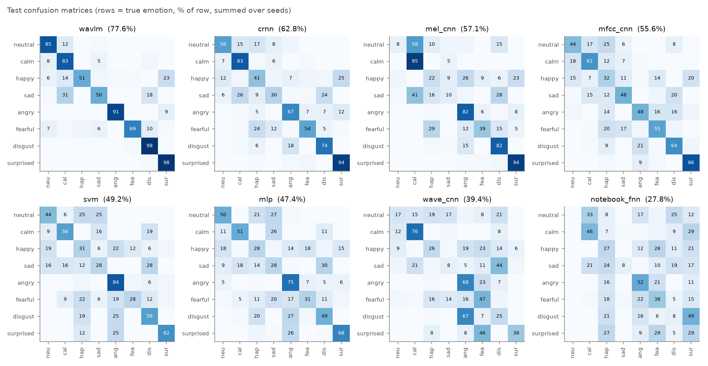

# Speech Emotion Recognition: 8 audio classifiers compared

**Detect emotion in speech, and see which way of feeding audio to a model works best.**
Raw waveform, MFCCs, mel-spectrograms, handcrafted features or a pretrained speech model:
eight architectures trained on the same data, split and training loop in PyTorch, evaluated on **speakers never seen
during training**.

`speech-emotion-recognition` · `audio-classification` · `pytorch` · `ravdess` · `wavlm` · `mel-spectrogram` · `mfcc` ·
`crnn` · `cnn` · `self-supervised-learning` · `deep-learning` · `librosa` · `emotion-detection`



## Results

RAVDESS speech, 8 emotions, **speaker-independent split** (train actors 1-18, val 19-20, test 21-24).
Mean ± std over 3 seeds. Chance = 12.5 %.

| model | input | test accuracy | test macro-F1 | params | train time / run (CPU) |
|---|---|---|---|---|---|
| `wavlm` | pretrained WavLM states (frozen) | **77.6** ± 1.3 % | 76.7 ± 1.2 % | 0.40 M (head) | 52 s |
| `crnn` | log-mel spectrogram | **62.8** ± 0.4 % | 60.8 ± 1.1 % | 0.32 M | 426 s |
| `mel_cnn` | log-mel spectrogram | **57.1** ± 1.5 % | 48.9 ± 3.4 % | 0.36 M | 445 s |
| `mfcc_cnn` | MFCC sequence | **55.6** ± 0.5 % | 54.5 ± 0.7 % | 0.17 M | 118 s |
| `svm` | handcrafted features | **49.2** ± 0.0 % | 48.0 ± 0.0 % | – | 1 s |
| `mlp` | handcrafted features | **47.4** ± 0.9 % | 46.4 ± 1.0 % | 0.27 M | 212 s |
| `wave_cnn` | raw waveform | **39.4** ± 2.2 % | 36.6 ± 2.8 % | 0.15 M | 137 s |
| `notebook_fnn` | original notebook pipeline | **27.8** ± 3.4 % | 24.0 ± 3.1 % | 1.48 M | 77 s |

**What the numbers say**

- **Pretrained speech models win by a wide margin.** A frozen WavLM plus a 0.4 M-parameter head reaches 77.6 %,
  2.8× the original notebook. With only 1,080 training clips, features learned from thousands of hours of speech beat
  anything trained from scratch.
- **Among from-scratch models, time-frequency inputs beat raw audio.** Spectrogram and MFCC models (55-63 %) beat
  the raw-waveform CNN (39 %), which has to learn its own filterbank from too little data.
- **Modelling time helps.** The CRNN (CNN + BiGRU + attention) beats the plain 2D CNN on the same log-mel input.
- **Feature scaling matters more than depth.** The original notebook features (per-clip min-max scaling, deep MLP with
  no regularisation) reach 28 %. The same feature families, standardised and pooled with mean + std, reach 47-49 %
  even with a plain SVM.
- **Hardest emotions:** *sad* and *happy*. They are confused with *calm* and *surprised* respectively (see the confusion
  matrices below).

> Many papers report 80-90 %+ on RAVDESS, but with **random** splits where the same actors appear in train and test.
> This repo tests on unseen actors, which is harder and closer to real use.

### Training curves

Train vs validation loss and accuracy per epoch (mean over seeds, band = min/max, dotted = epoch kept by early stopping).
`mlp`, `wavlm` and `notebook_fnn` overfit quickly, so early stopping matters there. The CNNs are still improving at
epoch 40: they were trained on a shared laptop CPU, and more epochs on a GPU should push them higher
(`python train.py --model crnn --epochs 100`).



### Per-emotion performance





## The models: one per way of representing audio

| model | what the model sees | architecture |
|---|---|---|
| `notebook_fnn` | 199 features averaged over the clip (MFCC, chroma, mel, contrast, tonnetz), min-max per clip | the original Colab network: 6 dense ReLU layers |
| `svm` | 386 handcrafted features (same families, mean **and** std, standardised) | RBF SVM, C tuned on validation |
| `mlp` | same 386 features | 2-layer MLP with BatchNorm + dropout |
| `wave_cnn` | **raw waveform** (3 s × 16 kHz) | 1D CNN; a wide strided first conv learns its own filterbank (M5-style) |
| `mfcc_cnn` | **MFCC sequence** (40 × 151 frames) | 1D CNN over time, coefficients as channels |
| `mel_cnn` | **log-mel spectrogram** (64 × 151) | 2D VGG-style CNN, spectrogram as an image |
| `crnn` | log-mel spectrogram | CNN → BiGRU → attention pooling |
| `wavlm` | **self-supervised speech model** ([WavLM base+](https://huggingface.co/microsoft/wavlm-base-plus), frozen) | learned weighted sum of its 13 layers (mean+std pooled) → MLP head |

All neural models share one training loop: AdamW, one-cycle LR, label smoothing 0.1, early stopping on validation
macro-F1. The waveform models compute their front-end on the fly (`LogMel` / `MFCC` in `models.py`), so they get
augmentation for free: random time shift, noise at 15-40 dB SNR and SpecAugment.
`notebook_fnn` keeps the original features and network, but uses this training loop, so the comparison is about
features and architecture rather than optimiser settings.

## Quick start

```bash
pip install -r requirements.txt
python prepare_ravdess.py     # downloads RAVDESS (~200 MB) and splits it by actor -> data/ravdess/{train,val,test}
python compare.py             # trains all 8 models x 3 seeds, then writes results/RESULTS.md and every figure
```

Train one model, use your own data, or classify a clip:

```bash
python train.py --model crnn --epochs 100                          # one model, longer
python train.py --model wavlm --backbone facebook/wav2vec2-base    # any HF wav2vec2 / HuBERT / WavLM checkpoint
python train.py --model mel_cnn --data /path/to/datasets           # your own folder with train/ val/ test/ .wav files
python predict.py clip.wav --model wavlm                           # top-3 emotions for one file
python report.py                                                   # rebuild table + figures from results/*.json
```

Labels are read from the file name: original RAVDESS names (`03-01-05-01-02-01-12.wav`, 3rd field = emotion) or
`<id>-<id>-<emotion>.wav` (last field). A GPU is used automatically when available (on Colab:
*Runtime → Change runtime type → GPU*).

## Repository layout

```
data.py              audio loading, labels, handcrafted + notebook features, caching
models.py            all 8 architectures + front-ends (LogMel, MFCC, SpecAugment)
train.py             train/evaluate one model; logs per-epoch loss/accuracy/F1 to results/<model>_seed<n>.json
compare.py           run every model x seed (resumable), then build the report
report.py            results table + figures (accuracy comparison, training curves, confusion matrices, per-class F1)
predict.py           inference on a single .wav
prepare_ravdess.py   download + speaker-independent split
results/             metrics JSON (with full training history) and figures for every run
```

## Dataset

[RAVDESS](https://zenodo.org/records/1188976) (Livingstone & Russo, 2018), speech subset: 1,440 clips, 24 actors,
8 emotions (neutral, calm, happy, sad, angry, fearful, disgust, surprised). Licensed CC BY-NC-SA 4.0. It is downloaded
by `prepare_ravdess.py` and not redistributed here.
