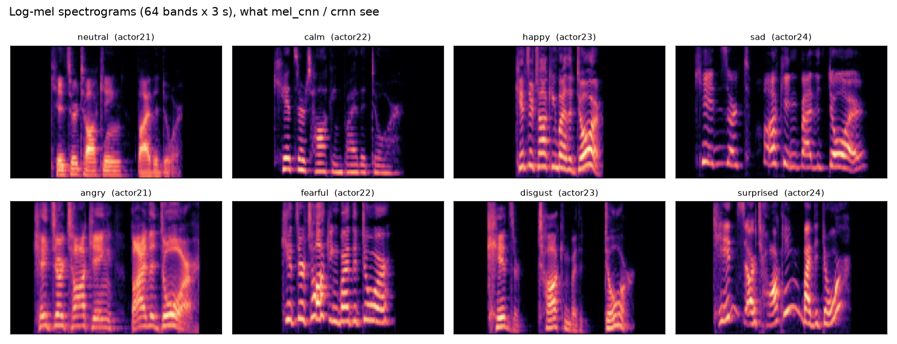

# Audio samples

Eight RAVDESS clips, one per emotion. They come from the **test actors (21-24)**, so no model heard these voices
during training. All actors say the same sentence ("Kids are talking by the door"), so only *how* it is said changes.
The clips are 16 kHz mono, with leading and trailing silence trimmed (the same preprocessing the models get).

Click a file, then the download button on GitHub, to listen.

| clip | true emotion | `wavlm` prediction (top-3) | |
|---|---|---|---|
| [01_neutral_actor21.wav](01_neutral_actor21.wav) | neutral | calm 55% · neutral 31% · happy 5% | ✗ |
| [02_calm_actor22.wav](02_calm_actor22.wav) | calm | **calm 41%** · disgust 36% · sad 10% | ✓ |
| [03_happy_actor23.wav](03_happy_actor23.wav) | happy | surprised 54% · happy 15% · fearful 11% | ✗ |
| [04_sad_actor24.wav](04_sad_actor24.wav) | sad | **sad 33%** · happy 27% · disgust 25% | ✓ |
| [05_angry_actor21.wav](05_angry_actor21.wav) | angry | **angry 76%** · happy 17% · neutral 3% | ✓ |
| [06_fearful_actor22.wav](06_fearful_actor22.wav) | fearful | **fearful 75%** · happy 9% · sad 8% | ✓ |
| [07_disgust_actor23.wav](07_disgust_actor23.wav) | disgust | **disgust 92%** · surprised 3% · angry 3% | ✓ |
| [08_surprised_actor24.wav](08_surprised_actor24.wav) | surprised | **surprised 75%** · angry 10% · disgust 5% | ✓ |

6 / 8 correct (`wavlm`, seed 0). The two mistakes are the model's most common confusions on the full test set:
neutral heard as calm, happy heard as surprised.

Reproduce: `python examples/05_classify_samples.py --model wavlm` (after `python train.py --model wavlm`).

*Log-mel spectrograms (64 bands × 3 s): what `mel_cnn` and `crnn` see. Each one is normalised per clip, so loudness
is gone; what is left is the pitch contour (spacing and movement of the harmonics), timing and the energy at high
frequencies. Angry has the most high-frequency energy; surprised shows the largest pitch swings. Made by
`python examples/01_listen_to_samples.py`.*

## Licence

These clips are from RAVDESS (Livingstone & Russo, 2018, https://doi.org/10.1371/journal.pone.0196391), licensed
[CC BY-NC-SA 4.0](https://creativecommons.org/licenses/by-nc-sa/4.0/). They are redistributed here unchanged except
for resampling and silence trimming, for non-commercial use under the same licence.
