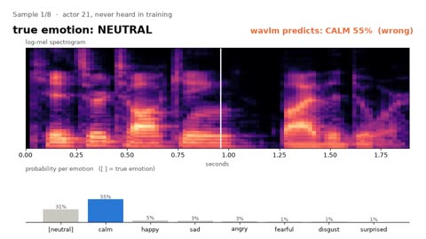
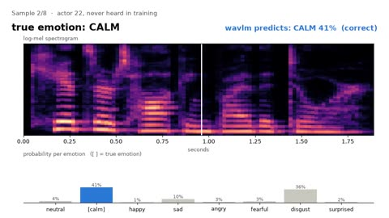
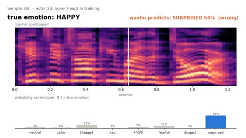
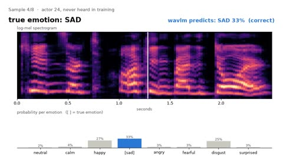
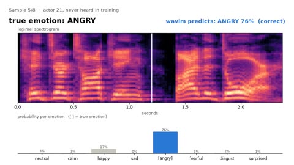
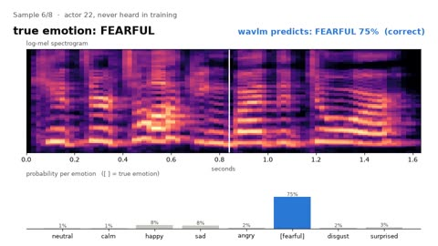
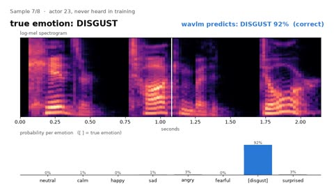
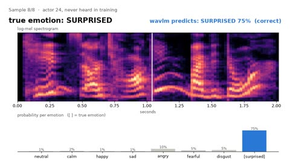

# Audio samples

Eight RAVDESS clips, one per emotion. They come from the **test actors (21-24)**, so no model heard these voices
during training. All actors say the same sentence ("Kids are talking by the door"), so only *how* it is said changes.
The clips are 16 kHz mono, with leading and trailing silence trimmed (the same preprocessing the models get).

**Click a picture to play the clip with sound** (spectrogram with a moving playhead, true emotion, and `wavlm`'s
probability for each of the 8 emotions).

<table>
<tr>
<td align="center"> 
▶ <b>true: neutral</b> · predicted: calm 55% ❌ · <a href="01_neutral_actor21.wav">wav</a></td>
<td align="center"> 
▶ <b>true: calm</b> · predicted: calm 41% ✅ · <a href="02_calm_actor22.wav">wav</a></td>
</tr>
<tr>
<td align="center"> 
▶ <b>true: happy</b> · predicted: surprised 54% ❌ · <a href="03_happy_actor23.wav">wav</a></td>
<td align="center"> 
▶ <b>true: sad</b> · predicted: sad 33% ✅ · <a href="04_sad_actor24.wav">wav</a></td>
</tr>
<tr>
<td align="center"> 
▶ <b>true: angry</b> · predicted: angry 76% ✅ · <a href="05_angry_actor21.wav">wav</a></td>
<td align="center"> 
▶ <b>true: fearful</b> · predicted: fearful 75% ✅ · <a href="06_fearful_actor22.wav">wav</a></td>
</tr>
<tr>
<td align="center"> 
▶ <b>true: disgust</b> · predicted: disgust 92% ✅ · <a href="07_disgust_actor23.wav">wav</a></td>
<td align="center"> 
▶ <b>true: surprised</b> · predicted: surprised 75% ✅ · <a href="08_surprised_actor24.wav">wav</a></td>
</tr>
</table>

6 / 8 correct (`wavlm`, seed 0). The two mistakes are the model's most common confusions on the full test set:
neutral heard as calm, happy heard as surprised.

Reproduce: `python examples/05_classify_samples.py --model wavlm` and `python examples/06_render_sample_videos.py`
(after `python train.py --model wavlm`).

*Log-mel spectrograms (64 bands × 3 s): what `mel_cnn` and `crnn` see. Each one is normalised per clip, so loudness
is gone; what is left is the pitch contour (spacing and movement of the harmonics), timing and the energy at high
frequencies. Angry has the most high-frequency energy; surprised shows the largest pitch swings. Made by
`python examples/01_listen_to_samples.py`.*

## Licence

These clips are from RAVDESS (Livingstone & Russo, 2018, https://doi.org/10.1371/journal.pone.0196391), licensed
[CC BY-NC-SA 4.0](https://creativecommons.org/licenses/by-nc-sa/4.0/). They are redistributed here unchanged except
for resampling and silence trimming, for non-commercial use under the same licence.
